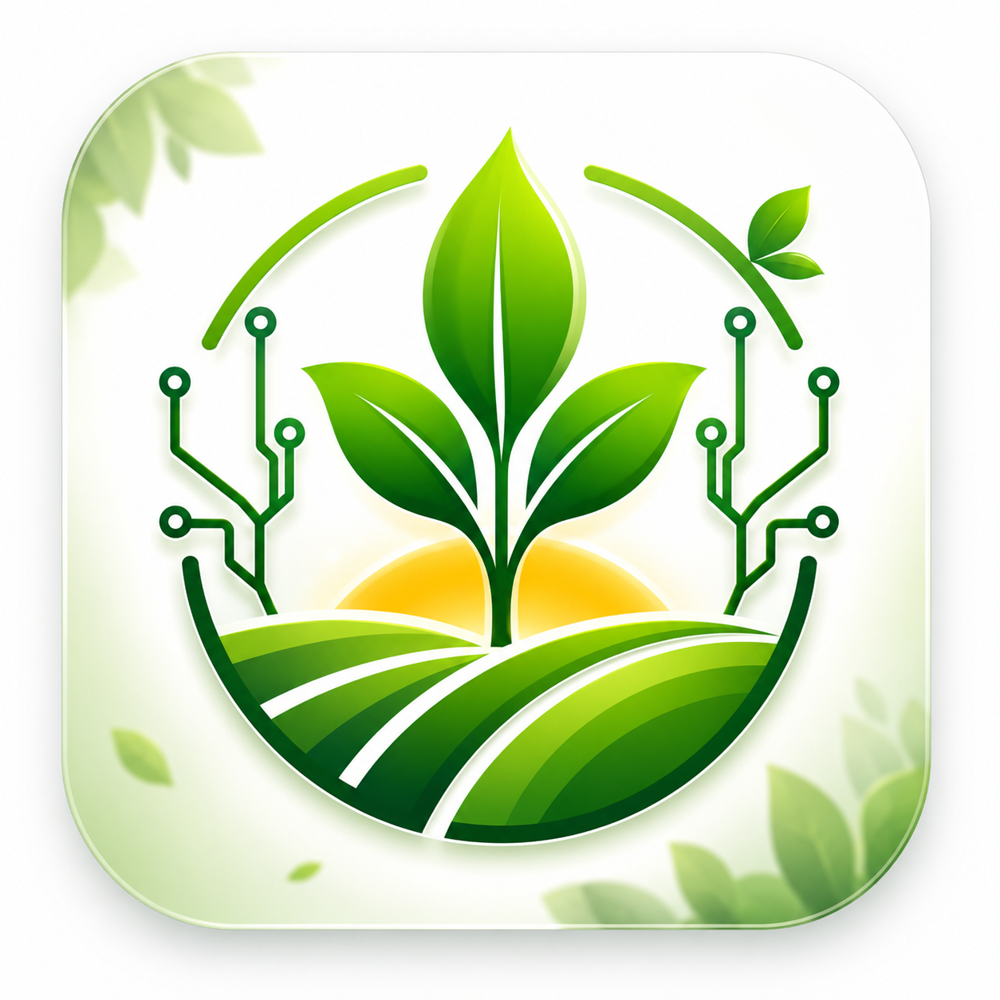

# 🌱 AgriAI — Smart Agriculture Assistant

<p align="center">
  <strong>AI-powered crop insights for smarter farming decisions</strong><br/>
  Crop disease recognition • Yield estimation • Weather-aware farm support
</p>

<p align="center">
  
</p>

<p align="center">
  
  
  
  
  
  <a href="https://github.com/zerokhizar-byte/AgriAI/actions/workflows/flutter-ci.yml"></a>
</p>

AgriAI is a Flutter-based smart agriculture application being developed to help farmers and agriculture learners access crop-related information and AI-assisted insights from a mobile interface. The project brings together machine-learning inference, Firebase-backed application services, and practical farming tools.

> **Project status:** Active development. Features, model coverage, supported devices, and backend configuration may change. This repository README describes the code currently committed to the default branch; check the source and release notes for the latest implementation status.

## ✨ Project goals

- Make crop-health information easier to access through image-based disease recognition.
- Explore data-driven crop-yield estimation using farm, soil, and weather inputs.
- Bring useful agriculture information and tools into one mobile application.
- Provide a clean, accessible interface with a green agriculture-oriented visual language.

## 🌾 Key modules

| Module | Purpose | Current repository status |
|---|---|---|
| Crop disease detection | Analyze a selected leaf image using an ONNX image-classification model. | ONNX inference service and 19-class mapping are present in the committed source. |
| Crop-yield prediction | Estimate yield from crop, soil, weather, and farm-input parameters. | Under active development; verify the committed model assets and screen before using this module. |
| Authentication | User sign-in and registration flows using Firebase Authentication. | Firebase-related dependencies and authentication screens/services are present. |
| Agriculture assistant | Provide an in-app agriculture information experience. | Service integration is present; external AI credentials/configuration may be required. |
| Weather and recommendations | Support weather information and farming guidance. | Screens/routes are present; availability depends on the configured data services. |
| Notifications | Support app notifications and messaging integrations. | Firebase Messaging and local-notification dependencies are included. |

## 🧠 Machine-learning components

### Crop disease recognition

The committed disease-detection service:

- Loads an ONNX model from the Flutter assets.
- Resizes the selected image to **224 × 224**.
- Applies RGB channel normalization using ImageNet mean and standard-deviation values.
- Runs inference with ONNX Runtime.
- Maps the model output to **19 crop/disease classes** using `assets/models/class_names.json`.
- Presents disease information and suggested management guidance through the application layer.

Supported crop groups in the class mapping include **corn, pepper, potato, and tomato**. Model predictions are informational and should be confirmed by a qualified agricultural expert before treatment decisions.

### Crop-yield estimation

The project includes a crop-yield prediction workflow under development. The intended model inputs cover:

- Soil nutrients: nitrogen (N), phosphorus (P), and potassium (K)
- Soil properties: pH, moisture, and organic carbon
- Weather and location: temperature, humidity, rainfall, sunlight, wind speed, and altitude
- Farm inputs: fertilizer and pesticide usage
- Farm context: crop type, soil type, region, season, and irrigation type

The model's output is an estimated yield in tonnes per hectare. Predictions depend on the training dataset and should not be interpreted as guaranteed harvest outcomes. Check the current asset declarations and model files before expecting this feature to run from a fresh clone.

## 🛠️ Technology stack

- **Framework:** Flutter
- **Language:** Dart
- **Machine-learning inference:** ONNX Runtime for Flutter
- **Image processing:** Dart image package
- **Backend services:** Firebase Core, Authentication, Cloud Firestore, Cloud Messaging, Remote Config, and Analytics
- **Device capabilities:** Image picker, geolocation, speech input/output, local notifications
- **External integrations:** HTTP and URL launcher

Package versions and the complete dependency list are maintained in [pubspec.yaml](pubspec.yaml).

## 📁 Project structure

```text
AgriAI/
├── android/                 # Android platform project
├── assets/
│   ├── images/              # App images and branding
│   ├── animations/          # App animation assets
│   └── models/              # On-device ML model assets and class mapping
├── lib/
│   ├── core/                # Shared services, theme, and app foundations
│   ├── navigation/          # App navigation
│   ├── screens/             # Application screens and feature flows
│   ├── widgets/             # Reusable UI components
│   └── main.dart            # Application entry point
├── test/                    # Automated tests
├── pubspec.yaml             # Flutter dependencies and asset declarations
└── README.md
```

The structure above is a high-level guide; folders and files may evolve during development.

## 🚀 Getting started

### Prerequisites

Install:

- Flutter SDK compatible with the constraints in `pubspec.yaml`
- Dart SDK bundled with Flutter
- Android Studio or VS Code with Flutter and Dart extensions
- Android SDK and an emulator or physical Android device

Check your setup:

```bash
flutter doctor
```

### 1. Clone the repository

```bash
git clone https://github.com/zerokhizar-byte/AgriAI.git
cd AgriAI
```

### 2. Install dependencies

```bash
flutter pub get
```

### 3. Configure Firebase

This application uses Firebase packages. To run Firebase-dependent features:

1. Create or select a Firebase project that you are authorized to use.
2. Register the Android application using the application ID configured in the Android project.
3. Configure the FlutterFire options for your own Firebase project.
4. Add the appropriate platform configuration files locally.
5. Enable only the Firebase products required by the features you intend to test.

Do not commit private service-account credentials, signing keys, production secrets, or personal environment files. Firebase client configuration files and API keys are not substitutes for server-side security; apply appropriate API restrictions and secure Firebase Authentication, Firestore, and Storage rules.

### 4. Run the application

```bash
flutter run
```

### 5. Run static analysis and tests

```bash
flutter analyze
flutter test
```

## 🔐 Security and configuration

Please read [SECURITY.md](SECURITY.md) before reporting a vulnerability. For ordinary setup and usage questions, see [SUPPORT.md](SUPPORT.md).

Before publishing or deploying:

- Never commit service-account JSON files, private keys, keystores, signing passwords, access tokens, or unredacted environment files.
- Keep local secrets in environment-specific configuration and provide safe example templates where needed.
- Restrict Firebase and other API keys to the applications and APIs that require them.
- Review Firestore and Storage security rules; never rely on client-side checks for authorization.
- Do not include real user data, logs containing personal information, or private datasets in commits.
- If a credential has ever been committed, rotate/revoke it. Removing it from the latest commit does not remove it from Git history.

## 🧪 Model and data limitations

- Model quality depends on the source dataset, class balance, labeling quality, and how well deployment images resemble training images.
- A successful ONNX inference test confirms runtime compatibility for that test; it does not establish real-world accuracy.
- Disease predictions can be affected by lighting, blur, background clutter, leaf age, and crop variety.
- Yield estimates are only as reliable as the input measurements and the training data's representativeness.
- Validate models on independent, real-world field data before using predictions for operational or financial decisions.

## 📚 Project documentation

- [Architecture overview](docs/ARCHITECTURE.md)
- [Disease detection model card](docs/DISEASE_MODEL_CARD.md)
- [Data and privacy notes](docs/DATA_AND_PRIVACY.md)
- [Changelog](CHANGELOG.md)
- [Citation metadata](CITATION.cff)
- [Contributing guide](CONTRIBUTING.md)
- [Code of Conduct](CODE_OF_CONDUCT.md)
- [Security policy](SECURITY.md)
- [Support guide](SUPPORT.md)

## 🗺️ Development roadmap

- [x] Flutter application foundation and navigation
- [x] ONNX-based disease inference service in committed source
- [ ] Complete and validate the farmer-facing yield prediction workflow
- [ ] Independent field-image and field-yield validation
- [ ] Complete Firebase rules and production configuration review
- [ ] Expand documentation, screenshots, and release packaging
- [ ] Accessibility, localization, and device-level testing

## 🤝 Contributing

Contributions, bug reports, and thoughtful suggestions are welcome. Please read [CONTRIBUTING.md](CONTRIBUTING.md), follow the [Code of Conduct](CODE_OF_CONDUCT.md), and use the GitHub issue and pull-request templates.

1. Fork the repository.
2. Create a feature branch.
3. Make focused changes and add tests where practical.
4. Run `flutter analyze` and `flutter test`.
5. Open a pull request describing the change and how it was tested.

Please do not include private credentials, proprietary datasets, or personal information in issues or pull requests.

## 📄 License

This project is distributed under the **MIT License**. See [LICENSE](LICENSE) for the complete license text and conditions. Third-party packages, datasets, model weights, images, and other external assets may have separate licenses or usage terms; those terms continue to apply.

## 👨‍💻 Project

**AgriAI — Smart Agriculture Assistant**  
GitHub: [@zerokhizar-byte](https://github.com/zerokhizar-byte)  
Repository: [zerokhizar-byte/AgriAI](https://github.com/zerokhizar-byte/AgriAI)

---

<p align="center">
  <sub>Built with Flutter • Designed for smarter agriculture</sub>
</p>
